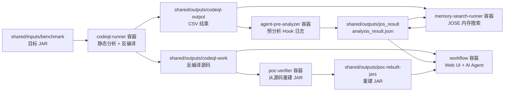

# Showmaker

JVM 内存马自动化挖掘与验证流水线。

本项目通过 **CodeQL 静态分析 + Java Agent 运行时 Hook + 内存搜索 + PoC 验证**，自动化发现和验证 JVM 内存马注入点。

---

## 1. 总览架构



关键容器：

- **codeql-runner**：反编译目标 JAR，构建 CodeQL 数据库，输出静态分析 CSV。
- **agent-pre-analyzer**：基于 CSV 驱动 DynamicTracer，生成 `analysis_result.json`。
- **memory-search-runner**：基于断点配置 + JOSEarcher 做批量内存搜索。
- **workflow**：统一的 Web 控制台与 AI 集成入口。
- **poc-verifier**：基于反编译源码重建 JAR，用于验证生成的 PoC。

---

## 2. 标准输入 / 输出目录规范

**所有容器共享文件统一通过 `shared/` 管理**，不再直接使用散落在根目录的路径。

### 2.1 Inputs（只读输入）

宿主机路径：`shared/inputs/`：

- `shared/inputs/benchmark/`  
  - 存放待分析的目标 JAR 及其附带样例  
  - `showmaker-config.yml` 中的 `target.jar_path` 指向这里，例如：  
    `shared/inputs/benchmark/druid_filter_mem-0.0.1-SNAPSHOT.jar`
- `shared/inputs/dynamictracer/DynamicTracer-1.0-SNAPSHOT.jar`  
  - DynamicTracer Java Agent 构件
- `shared/inputs/breakpoint-config/breakpoint-config.json`  
  - 断点 / Hook 配置文件，供 DynamicTracer / 内存搜索使用

### 2.2 Outputs（写入输出）

宿主机路径：`shared/outputs/`：

- `shared/outputs/codeql-output/`  
  - CodeQL 结果，`*.csv` / `*.bqrs`
- `shared/outputs/codeql-databases/`  
  - CodeQL 数据库（可复用），由 codeql-runner 生成
- `shared/outputs/codeql-work/`  
  - 反编译结果目录，包含：
    - `decompiled-with-deps/`：带依赖的完整源码树
    - 反编译产出的 `pom.xml`、`target/` 等
- `shared/outputs/jos_result/`  
  - 预分析 & 内存搜索结果：
    - `ctf_hook_logs_*.json`
    - `analysis_result.json` / `analysis_result.dedup.json`
    - `bp_search_*_result.jsonl` / `bp_search_*_error.log`
- `shared/outputs/logs/`  
  - 各容器输出的日志（例如 memory-search-runner 的运行日志）
- `shared/outputs/poc-rebuilt-jars/`  
  - poc-verifier 重新构建出的 JAR，用于后续 PoC 验证

> 约定：**任何新容器如果需要共享输入或输出，都应只读挂载 `shared/inputs`，写入 `shared/outputs`。**

---

## 3. 容器挂载约定（摘要）

只列出与 `shared/` 相关的关键挂载，完整内容见 `docker-compose.yml`。

- **codeql-runner**
  - `/input` ← `./shared/inputs/benchmark`
  - `/output` ← `./shared/outputs/codeql-output`
  - `/opt/databases` ← `./shared/outputs/codeql-databases`
  - `/opt/work` ← `./shared/outputs/codeql-work`

- **agent-pre-analyzer**
  - `/app/atools/benchmarks` ← `./shared/inputs/benchmark`
  - `/app/atools/agent/DynamicTracer-1.0-SNAPSHOT.jar` ← `./shared/inputs/dynamictracer/DynamicTracer-1.0-SNAPSHOT.jar`
  - `/app/atools/agent/config/breakpoint-config.json` ← `./shared/inputs/breakpoint-config/breakpoint-config.json`
  - `/app/atools/agent/jos_result` ← `./shared/outputs/jos_result`
  - `/app/codeql-output` ← `./shared/outputs/codeql-output`

- **memory-search-runner**
  - 与 agent-pre-analyzer 一致复用 DynamicTracer / benchmark / breakpoint-config
  - `/app/atools/agent/jos_result` ← `./shared/outputs/jos_result`
  - `/app/codeql-output` ← `./shared/outputs/codeql-output`
  - `/app/logs` ← `./shared/outputs/logs`

- **workflow**
  - `/opt/work` ← `./shared/outputs/codeql-work`
  - `/opt/databases` ← `./shared/outputs/codeql-databases`
  - `/opt/codeql-output` ← `./shared/outputs/codeql-output`
  - `/app/atools/benchmarks` ← `./shared/inputs/benchmark`
  - `/app/atools/agent/DynamicTracer-1.0-SNAPSHOT.jar` ← `./shared/inputs/dynamictracer/DynamicTracer-1.0-SNAPSHOT.jar`
  - `/app/atools/agent/config/breakpoint-config.json` ← `./shared/inputs/breakpoint-config/breakpoint-config.json`
  - `/app/atools/agent/jos_result` ← `./shared/outputs/jos_result`

- **poc-verifier**
  - `/input-decompiled` ← `./shared/outputs/codeql-work/decompiled-with-deps`
  - `/output` ← `./shared/outputs/poc-rebuilt-jars`

---

## 4. 运行流程（基于统一目录）

```bash
# 生成 .env（会解析 showmaker-config.yml 中的 shared/inputs 路径）
python3 scripts/config/generate_env_from_config.py

# 一键跑完整流水线
./run_pipeline.sh
```

流水线内部步骤（见 `run_pipeline.sh`）：

1. 清理旧结果：`shared/outputs/codeql-output/*`、`shared/outputs/jos_result/*`
2. `docker-compose run codeql-runner` → 写入 `shared/outputs/codeql-*`
3. `docker-compose run agent-pre-analyzer` → 预分析结果到 `shared/outputs/jos_result`
4. `docker-compose run memory-search-runner` → 内存搜索结果追加到 `shared/outputs/jos_result`
5. `docker-compose up -d workflow` → Web 控制台启动，消费 `shared/outputs/*`

---

## 5. 与 n8n 的集成（简要）

详见：`docs/n8n-webhook-integration.md`。

当前集成点：

- workflow 容器启动后，根据 `showmaker-config.yml` / `application.yml` 中的 `n8n.*` 配置触发 n8n webhook。
- n8n 工作流执行完后，通过 `POST /api/n8n/result` 把分析结果回传给 workflow。
- 分析结果未来将作为验证环节的输入（可落盘到 `shared/outputs` 下特定子目录）。

---

## 6. 开发者提示

- 若需要新增容器：
  - **输入一律约定挂载自**：`shared/inputs/...`
  - **输出一律约定写入**：`shared/outputs/...`
- 若需要新增配置项：
  - 推荐在 `showmaker-config.yml` 中仅描述「相对仓库根目录」下的 `shared/...` 路径，
  - 再由脚本或 Spring 配置转换为容器内部路径。

这样可以确保今后无论增加多少容器和脚本，整个系统的 I/O 入口始终清晰统一。 
